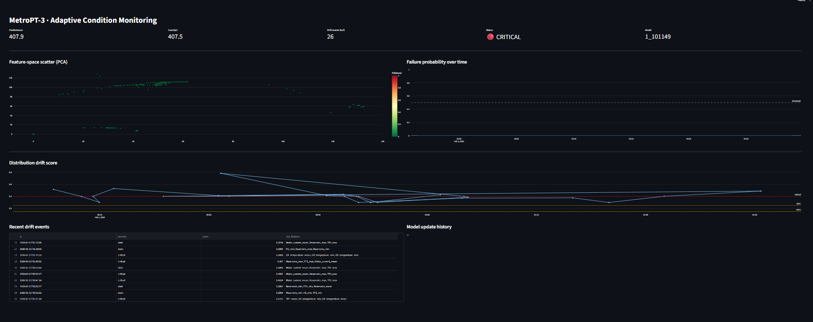
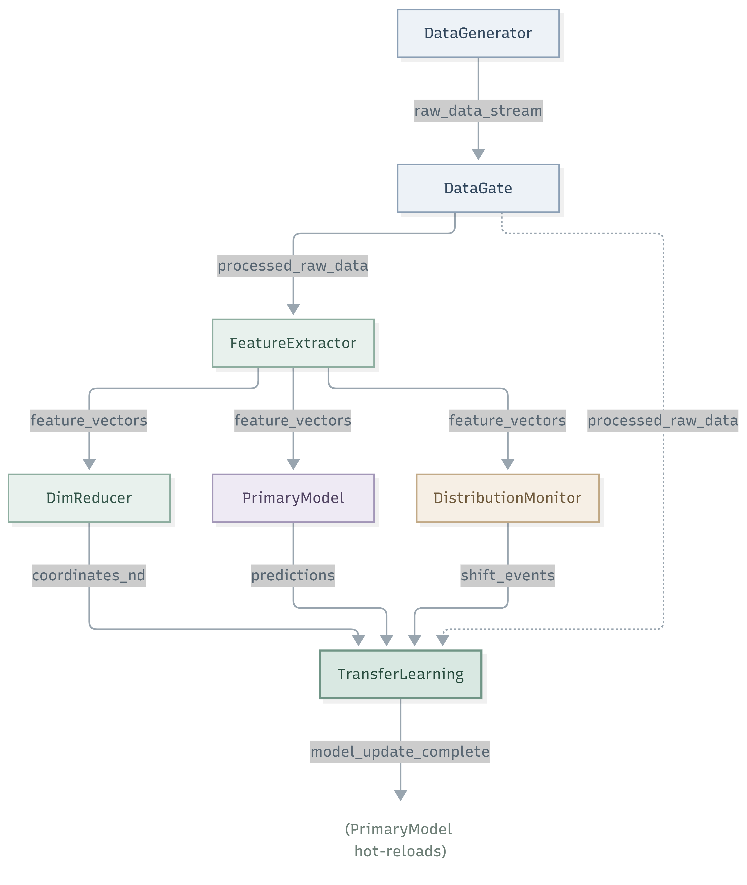
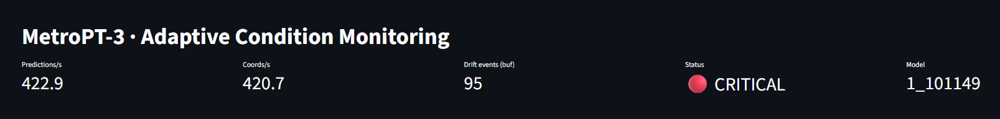
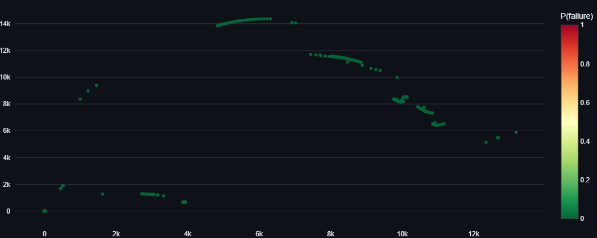
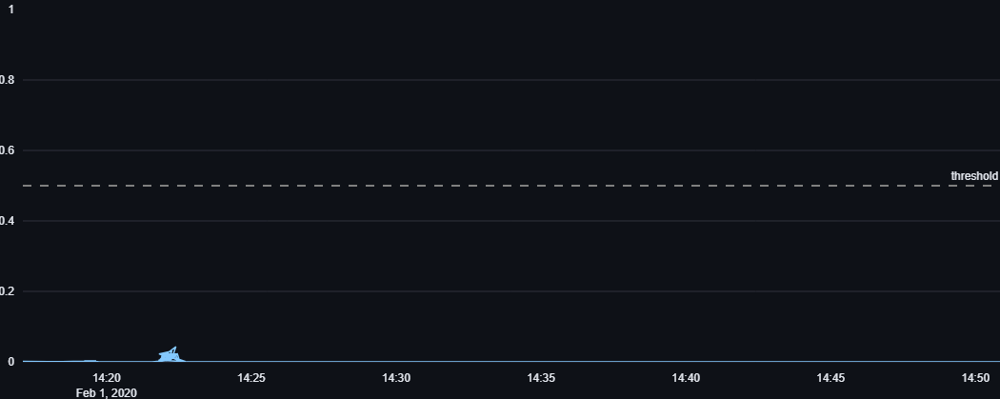
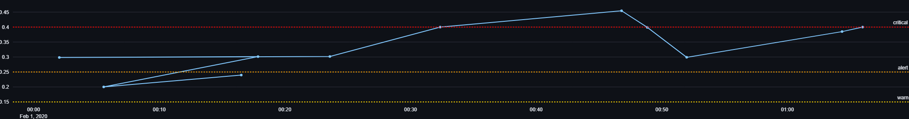
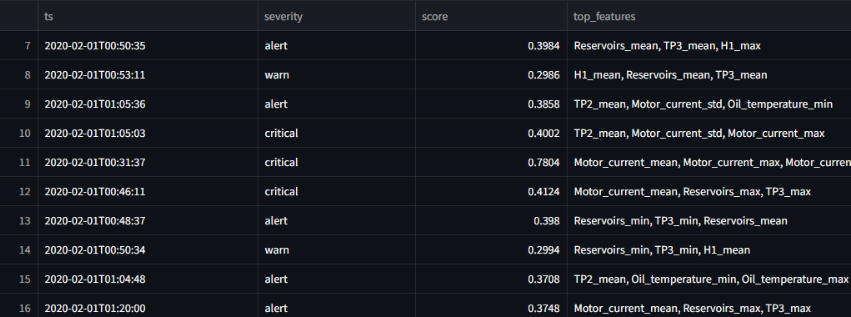

# Adaptive Condition Monitoring on MetroPT-3

An event-driven ML system that continuously monitors industrial sensor data, detects distribution shifts, and adapts its models automatically - all without human intervention.

Built on the open-source [MetroPT-3 dataset](https://archive.ics.uci.edu/dataset/791/metropt+3+dataset) (Metro do Porto air production unit, 15 sensors at 1 Hz), the system demonstrates a full **observe → detect → adapt** loop across seven Kafka-connected microservices, with a live Streamlit dashboard for operator supervision.

<!--
<p align="center">
  
</p> -->

---

## Why this project

Most predictive-maintenance ML systems assume the world doesn't change. Real machines degrade; sensor distributions drift; the model trained on last quarter's data quietly stops working.

This system takes the opposite stance: **the world always drifts, and the ML pipeline should notice and respond.** When statistical drift crosses a threshold, a retraining service pulls the most recent labeled data, trains a candidate model, evaluates it against the incumbent, and either promotes or rejects it. If promoted, the serving model hot-reloads without a restart — from that message onward, predictions carry the new model version.

The architecture is deliberately modular: seven single-responsibility services, all communicating asynchronously over Kafka topics. Any service can be replaced, scaled, or rewritten independently.

---

## Architecture

<p align="center">
  
</p>


| Service | Responsibility |
|---|---|
| **DataGenerator** | Streams the MetroPT-3 CSV at a configurable speed (default 600×). |
| **DataGate** | Validates schema, clips out-of-range values, flags quality issues, and derives labels from reported failure windows. |
| **FeatureExtractor** | Computes rolling-window statistics (mean/std/min/max over 30 s) for the 7 analog sensors + passes 8 digital signals through, producing 36-dim feature vectors. |
| **PrimaryModel** | XGBoost classifier serving live predictions with probability + label. Hot-reloads on promotion events. |
| **DimReducer** | PCA (with `StandardScaler`) fit on a bootstrap window; projects live feature vectors to 2D for visualization. |
| **DistributionMonitor** | Compares a rolling current window against a frozen baseline using per-feature KS distance. Emits `warn`/`alert`/`critical` events with cooldown to avoid alert storms. |
| **TransferLearning** | On `critical` events (with wall-clock cooldown), retrains an XGBoost candidate on recent labeled data, evaluates against the incumbent, and either promotes or rejects. |
| **UI (Streamlit)** | Live dashboard consuming all downstream topics for operator supervision. |
| **Orchestrator** | Single-command lifecycle for all services with dependency-ordered startup and clean shutdown. |


### Design principles

- **Event-driven.** No direct service-to-service calls. All communication is asynchronous over Kafka.
- **Contract-first.** Each message is a validated Pydantic DTO; contracts are versioned (`fe_version`, `model_version`, etc.) for auditability.
- **Bootstrap-then-serve.** Services that need calibration (DimReducer, DistributionMonitor) collect their first N samples live before beginning to publish.
- **Train-offline / serve-online.** PrimaryModel is trained via a standalone script; the service reads the latest artifact from `StorageManager`.
- **Adapt-in-place.** TransferLearning retrains during runtime; PrimaryModel picks up new models via `model_update_complete` messages without restart.
- **Every artifact is versioned.** UTC-timestamped model, baseline, and reducer files live under `data/artifacts/` for reproducibility.

## Data contracts

Every Kafka topic has a single writer and an explicit schema. Consumers may change independently; producers may not change a topic's schema without a version bump and a parallel-topic migration.

| Topic | Writer | Readers | DTO | Key | Version field | Retention |
|---|---|---|---|---|---|---|
| `raw_data_stream` | DataGenerator | DataGate | `RawDataDTO` | `tool_id` | — | 1 h |
| `processed_raw_data` | DataGate | FeatureExtractor, DistributionMonitor | `ProcessedRawDataDTO` | `tool_id` | `schema_version` | 1 h |
| `feature_vectors` | FeatureExtractor | PrimaryModel, DimReducer, DistributionMonitor | `FeatureVectorDTO` | `product_id` | `fe_version` | 6 h |
| `predictions` | PrimaryModel | DistributionMonitor, UI, Bridge | `PredictionDTO` | `product_id` | `model_version` | 24 h |
| `coordinates_nd` | DimReducer | UI, Bridge | `Coordinates2DDTO` | `product_id` | `dr_version` | 6 h |
| `shift_events` | DistributionMonitor | TransferLearning, UI, Bridge | `ShiftEventDTO` | `baseline_version` | `baseline_version` | 7 d |
| `model_update_complete` | TransferLearning | PrimaryModel, UI, Bridge | `ModelUpdateCompleteDTO` | — | `bundle.primary_version` | 30 d |

**Rules in force.**

- Compatible evolution (new optional field) is a minor version bump; readers must tolerate unknown fields.
- Breaking evolution (field removed or retyped) ships as `<topic>_v2` with a migration window where both topics run; readers switch one at a time.
- Keys are chosen for ordering guarantees: all messages for one tool land on the same partition, so FeatureExtractor's rolling window stays consistent.
- A production deployment would promote these contracts into a schema registry (Confluent Schema Registry with Avro) rather than Pydantic-at-the-boundary. This project keeps Pydantic for the lower barrier to entry.
  
---
## Delivery guarantees & backpressure

**Delivery semantics.** The pipeline runs **at-least-once** end to end.

- Producers use the Kafka Python client's idempotent mode, so a retried publish doesn't duplicate inside a session.
- Consumers auto-commit offsets every 5 s. A crash between a `handle()` call and its commit will reprocess that batch on restart.
- Downstream services tolerate replays because every message carries a monotonic timestamp, and operations are either idempotent (feature extraction is a pure function of its window) or additive with a cooldown (DistributionMonitor's severity cooldown suppresses a replayed shift alarm within the same cooldown window).

The dashboard bridge uses `auto_offset_reset="latest"` deliberately: the dashboard shows live state, and a reconnecting browser should not be shown hours of stale events.

**Backpressure policy per service.**

| Service | Policy on slow consumer | Policy on crash |
|---|---|---|
| **DataGenerator** | Blocks the producer; replay speed drops. | Exits; orchestrator restarts. CSV offset re-read from state file. |
| **DataGate / FeatureExtractor** | Natural Kafka backpressure (fetch pauses when poll loop stalls). | Reprocesses from last committed offset; feature window warms up for 30 s. |
| **PrimaryModel** | Same. Prediction lag surfaces as consumer lag on `feature_vectors`. | Reprocesses; idempotent since prediction is a pure function of input. |
| **DimReducer** | Same. On restart, re-reads the persisted PCA fit; skips bootstrap. | Reprocesses; transform is deterministic. |
| **DistributionMonitor** | Same. Baseline persisted; current window rebuilds within `DM_WINDOW_SIZE` messages. | Reprocesses; cooldowns reset, so a brief duplicate alarm is possible. |
| **TransferLearning** | Drops candidate retrains outside cooldown. Never queues. | Any in-flight retrain is abandoned; incumbent model remains active. |
| **Bridge → React** | Per-client asyncio queue, maxsize 500, **drop-oldest on full**. | Client reconnects via EventSource, resumes from `latest`. |

**Dead-letter topic.** Each service writes rejected messages (schema failures, out-of-range beyond clip tolerance, Pydantic validation errors) to `dlq_<service>`. DLQ topics have 30-day retention and are the first place to look during an incident.

---

## Observability

**Structured logs.** Every service logs line-delimited JSON with the same shape: `{ts, level, service, trace_id, msg, ...fields}`. The `trace_id` is minted by DataGate on ingest and copied verbatim into every downstream DTO, so one record can be followed across all seven services with a single `jq` filter.

**Metrics.** Each service exposes Prometheus metrics on `:9100/metrics`. Standard set per service:

| Metric | Type | Scope |
|---|---|---|
| `metropt_messages_in_total{topic}` | counter | all services |
| `metropt_messages_out_total{topic}` | counter | all services |
| `metropt_messages_dlq_total{reason}` | counter | all services |
| `metropt_handle_seconds{service}` | histogram (p50/p95/p99) | all services |
| `metropt_consumer_lag{topic,partition}` | gauge | scraped from Kafka admin API |
| `metropt_model_inference_seconds` | histogram | PrimaryModel only |
| `metropt_drift_score` | gauge | DistributionMonitor only |
| `metropt_e2e_latency_seconds` | histogram | Bridge (now() − predictions.ts) |

A Grafana dashboard JSON lives at `observability/grafana/metropt.json`.

**Health endpoints.** Each service exposes:

| Endpoint | Meaning |
|---|---|
| `GET /healthz` | Process is alive (Kubernetes liveness). |
| `GET /readyz` | Service has completed bootstrap (DimReducer's 500 samples, DistributionMonitor's 1000-sample baseline, PrimaryModel has a loaded artifact). |

**Tracing.** OpenTelemetry spans are emitted around each `handle()` call, with the DTO's `trace_id` propagated as the span's trace context. Local development uses an OTLP exporter to a Jaeger container in `docker-compose.yml`; production would point at the org's collector.

---

## Deployment

**Development mode.** All seven services run as threads in one Python process via the orchestrator. Kafka and ZooKeeper run in Docker. One `make run` command. Hot-reload of model artifacts works the same as in production. This is the mode the quickstart above describes.

**Production mode.** Each service ships as its own container; orchestration is Kubernetes with one Deployment per service.

```
deployment/
  docker/
    Dockerfile.base              # shared Python + uv layer
    Dockerfile.datagenerator     # FROM base, entrypoint = python -m metropt.services.data_generator
    Dockerfile.datagate
    ... (one per service)
  k8s/
    namespace.yaml
    kafka.yaml                   # Strimzi operator, 3 brokers, 3 partitions per topic
    datagate-deployment.yaml
    featureextractor-deployment.yaml
    primarymodel-deployment.yaml
    dimreducer-deployment.yaml
    distributionmonitor-deployment.yaml
    transferlearning-deployment.yaml
    bridge-deployment.yaml
    servicemonitors.yaml         # Prometheus Operator
```

---

## Live dashboard


The dashboard consumes four Kafka topics and renders:

**Header metrics** — Live throughput (predictions/sec, coords/sec), buffered drift events, current severity pill (🟢 healthy · 🟡 warn · 🟠 alert · 🔴 critical), and the active model version.



**Feature-space scatter (PCA)** — 2D projection of the 36-dim feature vectors, colored by predicted failure probability. Healthy operation clusters in green; pre-failure regions drift toward red.


**Failure probability over time** — The primary model's output, with the 0.5 decision threshold overlaid. Sudden climbs correspond to the model recognizing a degradation signature.


**Distribution drift score** — Per-message drift score with the warn/alert/critical thresholds drawn as horizontal reference lines. This is the diagnostic view of the DistributionMonitor.


**Recent drift events & model-update history** — Tabular views of the last ten shift events (with top drifting features) and the last ten retraining decisions (with AUPRC vs incumbent).



---

## Quickstart

### Prerequisites
- Python 3.11
- [uv](https://github.com/astral-sh/uv) for dependency management
- Docker Desktop (for Kafka + ZooKeeper)
- MetroPT-3 CSV: download from [UCI](https://archive.ics.uci.edu/dataset/791/metropt+3+dataset) or [Kaggle](https://www.kaggle.com/datasets/nargesdavari/metropt3-air-compressor) and place at `data/MetroPT3(AirCompressor).csv`

### Setup

```bash
# 1. Install dependencies
uv sync

# 2. Start Kafka + ZooKeeper
docker compose up -d

# 3. Create the 7 Kafka topics
uv run python -m metropt.scripts.create_topics

# 4. Train the initial primary model (~30 s)
uv run python -m metropt.scripts.train_primary
```

### Run

```bash
# Terminal 1 — start the full pipeline
make run

# Terminal 2 — start the dashboard
make ui
```

The dashboard is served at [http://localhost:8501](http://localhost:8501).

Give the pipeline ~60 seconds after startup: FeatureExtractor bootstraps for 30 s of stream time, DimReducer collects 500 samples, DistributionMonitor collects 1000 baseline samples. Once these complete, the dashboard populates and drift detection becomes active.

### Stop

Ctrl-C the orchestrator terminal; it shuts services down in reverse dependency order. Kafka and ZooKeeper remain running until `docker compose down`.

---

## Testing

```bash
uv run pytest -v tests
```

The suite covers:

- **DTO round-trips** — every message contract serializes and deserializes cleanly.
- **DTO validators** — probability ranges, severity levels, promotion decisions are enforced at the boundary.
- **Service unit tests** — each service's `handle()` is exercised offline with mocked Kafka; input topic routing, bootstrap gating, cooldown behavior, and edge cases are covered.

Continuous integration runs the full suite plus lint on every PR via GitHub Actions (`.github/workflows/ci.yml`).

---

## Configuration reference

Key settings live in `metropt/config/settings.py`:

| Setting | Default | Purpose |
|---|---|---|
| `REPLAY_SPEED` | `600` | Stream acceleration factor (600× = 6 hours of data per minute of wall-clock) |
| `FE_WINDOW_SECONDS` | `30` | Rolling-window size for feature statistics |
| `DR_BOOTSTRAP_SIZE` | `500` | Samples before PCA is fit |
| `DM_BASELINE_SIZE` | `1000` | Samples in the drift baseline |
| `DM_WINDOW_SIZE` | `500` | Rolling current window for KS comparison |
| `DM_THRESHOLDS` | `{warn: 0.15, alert: 0.25, critical: 0.40}` | Drift severity tiers |
| `TL_TRIGGER_SEVERITY` | `{"critical"}` | Which severities cause retraining |
| `TL_RETRAIN_COOLDOWN_SECS` | `120` | Wall-clock minimum between retrains |
| `TL_PROMOTION_MARGIN` | `0.02` | AUPRC delta required to promote a candidate |

All environment-configurable via matching `metropt_*` env vars.

---

## References

- Veloso, B., Ribeiro, R. P., Gama, J. & Pereira, P. M. *The MetroPT dataset for predictive maintenance.* Scientific Data 9, 764 (2022).
- Davari, N., Veloso, B., Ribeiro, R. P., Pereira, P. M. & Gama, J. *Predictive maintenance based on anomaly detection using deep learning for air production unit in the railway industry.* IEEE DSAA (2021).

---

## License

MIT.
